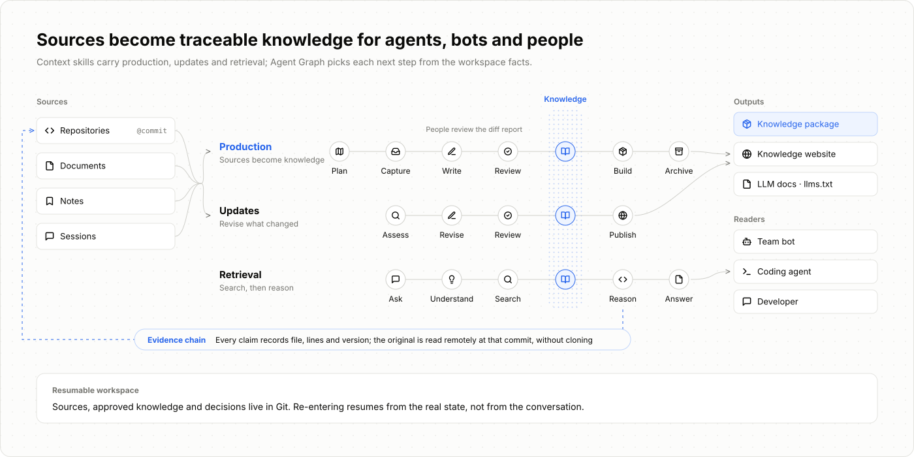

# Context

[](https://github.com/context4ai/context/actions/workflows/ci.yml)
[](https://www.npmjs.com/package/@c4a/context-cli)
[](./package.json)
[](./LICENSE)

**A knowledge workflow for engineering teams and their AI agents.**

Context turns code repositories, documents, notes and conversations into
reviewed, versioned knowledge in which every claim leads back to its source.
Agents read the knowledge first and follow its evidence chain to the original
only when they need exact detail.

[Documentation](https://context4ai.org/context/) ·
[Quick Start](https://context4ai.org/context/pages/2d2cb920187a515c51a72c1c7b071ab6.html) ·
[简体中文](./README.zh-CN.md) ·
[Contributing](./CONTRIBUTING.md) ·
[Release Notes](./CHANGELOG.md)

## Why Context

- **Knowledge as an index.** Indexer Skills extract what matters from each
  source and stack into a compact knowledge base, typically around 1/100 of the
  source size, and record where every claim came from.
- **Evidence you can follow.** Each section keeps its file, line range and
  revision, so an Agent can read the original remotely instead of cloning and
  searching it again. See [Evidence Chains](https://context4ai.org/context/pages/d2f41bdf9360d05ff944e1b475267498.html).
- **A workflow, not a summarizer.** Sources, structure, drafts, review and
  builds are explicit steps with recorded decisions. A team can stop, resume,
  review and update the same workspace over months.
- **Updates and versions.** When sources move, Context compares what changed,
  updates only the affected pages, and records a version with a changelog.
- **Several outputs from one workspace.** Agent knowledge packages,
  multilingual documentation websites, LLM documents and package Skills.

On real developer questions from a large team and production monorepo, Agents
using Context knowledge resolved more questions in less than half the time and
about a ninth of the cost of a plain LLM Wiki setup. See the
[Knowledge Retrieval Benchmark](https://context4ai.org/context/pages/06602fd2c6c83d3113540066149a34b9.html)
for the method and results.

## Quick start

Install the CLI and its Agent plugin once. The plugin is installed for the
Claude Code, Codex and Cursor hosts that are available on the machine:

```bash
npm install -g @c4a/context-cli@latest
context plugin install
```

Restart the Agent session and describe the knowledge you want:

```text
/c4a:context Build an Agent knowledge package from this repository and our
architecture documents. Keep code references traceable and ask me before
approving the final structure.
```

You do not need to learn lifecycle commands first. The Agent follows the
workflow, asks when a decision is yours, and reports what it produced. Continue
with [Installation](https://context4ai.org/context/pages/53535d85f2a932c36ba6afe78b0443ee.html)
and [The Workflow at a Glance](https://context4ai.org/context/pages/eaa1f43a31890e05489116bf68a03f9b.html).

| Entry | Use it to |
|---|---|
| `/c4a:context` | Create, produce, update, review and build a knowledge workspace |
| `/c4a:context-plan` | Plan a large project or a broad source update in stages |
| `/c4a:context-inspect-search` | Answer questions from knowledge and trace answers to their sources |
| `/c4a:context-repo-content` | Maintain same-repository docs and Skills without starting production |

The Code, Markdown, Note and Sessions Indexer Skills are selected by the
workflow rather than invoked directly. See
[Commands and Skills](https://context4ai.org/context/pages/2e3119bc24e49da0e10fbf2c002d5472.html).

## How it works



1. **Register sources** — repositories at pinned revisions, document
   directories, notes and conversation summaries.
2. **Capture evidence** — document bodies, code symbols, relationships and
   source fingerprints.
3. **Plan the structure** — the Agent proposes collections, pages and sections
   for confirmation.
4. **Write reviewable drafts** — every section stays bound to its evidence and
   is checked for coverage and stale inputs.
5. **Review and approve** — through an HTML review report, or delegated to the
   Agent when you choose.
6. **Verify, version and build** — the approved workspace becomes the declared
   outputs.

The workflow is defined with [Agent Graph](https://github.com/context4ai/agent-graph):
current workspace facts select the next legal step, and the Agent loads only
the procedures that step needs. Re-entering a workspace resumes from its real
state rather than from the conversation. Watch a
[sanitized replay of a real run](https://context4ai.github.io/context/case-studies/workflow/?lang=en)
or read [Why a Workflow](https://context4ai.org/context/pages/efa2b8e476ba9d77b6d0664b453e59bc.html).

Context itself never calls a model. The user owns goals, source permissions and
review decisions; the Agent reads evidence, proposes structure and writes;
Context records facts, validates evidence, applies decisions and builds
deterministically. See [Core Concepts](https://context4ai.org/context/pages/e7afa377a464a3453f2ed4ed2a90f3f7.html).

## Outputs

| Output | Description |
|---|---|
| [Knowledge package](https://context4ai.org/context/pages/d44c4a3b119c1c5101baa173791105e1.html) | Approved knowledge for Agents, with indexes, optional Skills and query helpers |
| [Documentation site](https://context4ai.org/context/pages/089c3c9e0212ca13bb27c8e8d2fe6080.html) | A static website with search, a knowledge-map navigation and [multiple languages](https://context4ai.org/context/pages/c1dc07fb24e9ea500fee02e9e275f4b7.html) |
| [LLM documents](https://context4ai.org/context/pages/7d888a31ded9bcd291bc79dcd6c87e26.html) | `llms.txt` and consolidated text for model context and evaluation |

Every build emits an inventory that maps distributed files back to approved
knowledge. Context stops at a complete local build; publishing belongs to your
hosting or registry tooling. The [Context documentation](https://context4ai.org/context/)
is itself a Context workspace, built from this repository and its sibling
projects ([source](https://github.com/context4ai/portal)).

## Ecosystem

| Project | Role |
|---|---|
| [Agent Graph](https://github.com/context4ai/agent-graph) | Graph Engineering for Agent Skills; the runtime behind the Context workflow |
| [Source Graph](https://github.com/context4ai/sourcegraph) | Code search and reading at pinned Git revisions; Context reads code evidence through it remotely |
| [Portal](https://github.com/context4ai/portal) | [context4ai.org](https://context4ai.org): the homepage and the documentation site |

## Repository map

| Module | Role | Documentation |
|---|---|---|
| `@c4a/context` | Declarative project SDK for sources, phases, review gates and outputs | [English](./packages/context/README.md) · [中文](./packages/context/README.zh-CN.md) |
| `@c4a/context-cli` | Local workflow runtime, Agent plugin and website builder | [English](./packages/context-cli/README.md) · [中文](./packages/context-cli/README.zh-CN.md) |
| `@c4a/core` | Shared schemas, identities, errors and extraction contracts | [English](./packages/core/README.md) · [中文](./packages/core/README.zh-CN.md) |
| `@c4a/extract` | Language-plugin protocol and repository extraction runner | [English](./packages/extract/README.md) · [中文](./packages/extract/README.zh-CN.md) |
| `@c4a/extract-ts` | TypeScript/JavaScript and TSX/JSX structure extraction | [English](./packages/extract-ts/README.md) · [中文](./packages/extract-ts/README.zh-CN.md) |
| `@c4a/extract-go` | Optional Go structure extraction | [English](./packages/extract-go/README.md) · [中文](./packages/extract-go/README.zh-CN.md) |
| `@c4a/extract-rush` | Optional Rush workspace structure index | [English](./packages/extract-rush/README.md) · [中文](./packages/extract-rush/README.zh-CN.md) |
| `@c4a/extract-mdx` | Optional MDX component and example catalog | [English](./packages/extract-mdx/README.md) · [中文](./packages/extract-mdx/README.zh-CN.md) |
| `@c4a/extract-proto` | Optional Protocol Buffers IDL catalog | [English](./packages/extract-proto/README.md) · [中文](./packages/extract-proto/README.zh-CN.md) |
| `@c4a/extract-thrift` | Optional Apache Thrift IDL catalog | [English](./packages/extract-thrift/README.md) · [中文](./packages/extract-thrift/README.zh-CN.md) |
| `@c4a/extract-contract` | Optional OpenAPI and GraphQL contract catalog | [English](./packages/extract-contract/README.md) · [中文](./packages/extract-contract/README.zh-CN.md) |
| `@c4a/extract-sql` | Optional dialect-bound SQL evidence | [English](./packages/extract-sql/README.md) · [中文](./packages/extract-sql/README.zh-CN.md) |
| `@c4a/extract-style` | Optional CSS and SCSS evidence | [English](./packages/extract-style/README.md) · [中文](./packages/extract-style/README.zh-CN.md) |
| `context-evidence-wasm` | Source Graph read plugin that attaches registered section sources | [English](./packages/context-evidence-wasm/README.md) |
| `@c4a/dev-cli` | Repository development and release menu | [English](./packages/dev-cli/README.md) · [中文](./packages/dev-cli/README.zh-CN.md) |
| `@c4a/tui` | Shared terminal components for development tools | [English](./packages/tui/README.md) · [中文](./packages/tui/README.zh-CN.md) |

[Module Layout](https://context4ai.org/context/pages/48ba914060b8913ca26c053abac47fac.html)
explains how these packages depend on each other and where a change lands;
[ARCHITECTURE.md](./ARCHITECTURE.md) covers the internals.

## Documentation

| Section | Start with |
|---|---|
| Getting Started | [What is Context](https://context4ai.org/context/pages/2b7a58617f9c9122c6995f6a8f98426f.html) · [Quick Start](https://context4ai.org/context/pages/2d2cb920187a515c51a72c1c7b071ab6.html) · [The Knowledge Workspace](https://context4ai.org/context/pages/cdf9148eedbd9888212333ab91eb1b42.html) |
| Guides | [Registering Sources](https://context4ai.org/context/pages/08a9b212fa4ad7acc9f41f2c6fc74733.html) · [Updating Knowledge](https://context4ai.org/context/pages/d44b1e3f9b763a0bea2081fd73781a64.html) · [Asking Questions](https://context4ai.org/context/pages/9f737b01f7c056374ecc2d13199e8600.html) · [Creating an Indexer](https://context4ai.org/context/pages/ea58e96a208549b9844ac19839769dcc.html) · [Building a Knowledge Service](https://context4ai.org/context/pages/f5d6d79f9a3763c3da3d1efa26331988.html) |
| How It Works | [Architecture Overview](https://context4ai.org/context/pages/7f25dc0aedcee13f99a215242910a729.html) · [Knowledge Lifecycle](https://context4ai.org/context/pages/cc571a5e90fab471ed74b49bac98cf0d.html) · [Knowledge for Agents](https://context4ai.org/context/pages/5481df1096e6386ed0dcfac3aa3f96ff.html) |
| Reference | [CLI Commands](https://context4ai.org/context/pages/a53289d9e9cbd12d13c1027feb6b47f1.html) · [Project API](https://context4ai.org/context/pages/1ff821a37b83918a98daf26a8d6c87ca.html) · [Skills](https://context4ai.org/context/pages/9c25851c53c836d2d640b54ee5fc671c.html) · [FAQ](https://context4ai.org/context/pages/eac245c4b0bc8346acc3bd56fa10ea6b.html) |

The documentation site has an [LLM-ready version](https://context4ai.org/context/llms.txt)
for Agents. Package-level references stay in this repository: the
[SDK guide](./packages/context/docs/README.md), the
[Agent integration guide](./packages/context-cli/README.md) and the
[plugin contract](./plugins/context/README.md).

## Contributing

Context uses Bun for development; published packages run on Node.js 20 or newer.

```bash
git clone https://github.com/context4ai/context.git
cd context
bun install
bun run verify
```

Read [CONTRIBUTING.md](./CONTRIBUTING.md) before opening a pull request and
[DEVELOPMENT.md](./DEVELOPMENT.md) for local CLI, plugin, verification and
release workflows. Questions go to [GitHub Discussions](https://github.com/context4ai/context/discussions)
(see [SUPPORT.md](./SUPPORT.md)); vulnerabilities follow [SECURITY.md](./SECURITY.md).
Participation is governed by the [Code of Conduct](./CODE_OF_CONDUCT.md).

## License

[MIT](./LICENSE). Third-party components are listed in
[THIRD_PARTY_NOTICES.md](./THIRD_PARTY_NOTICES.md).
