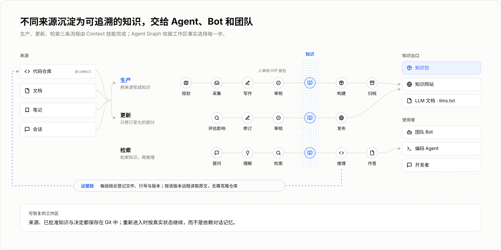

# Context

[](https://github.com/context4ai/context/actions/workflows/ci.yml)
[](https://www.npmjs.com/package/@c4a/context-cli)
[](./package.json)
[](./LICENSE)

**面向研发团队与 AI Agent 的知识工作流。**

Context 把代码仓库、文档、笔记和会话整理成经过审阅、带版本的知识，每条结论都能追溯到来源。Agent 先读知识，需要精确细节时再沿证据链读取原文。

[文档](https://context4ai.org/) ·
[快速开始](https://context4ai.org/context/pages/2d2cb920187a515c51a72c1c7b071ab6.html) ·
[English](./README.md) ·
[参与贡献](./CONTRIBUTING.md) ·
[发布说明](./CHANGELOG.md)

观看 4 分钟 Context 介绍视频：

[](https://context4ai.org/intro/)

文档站与英文共用同一地址，按浏览器语言或手动选择显示中文。

## 为什么用 Context

- **知识即索引。** Indexer 技能从每类来源、每种技术栈中抽取要点，形成紧凑的知识库（通常约为来源体积的百分之一），并登记每条结论的出处。
- **可追溯的证据。** 每个小节记录文件、行范围和版本，Agent 可以远程读取原文，不必重新克隆和检索。见[证据链](https://context4ai.org/context/pages/d2f41bdf9360d05ff944e1b475267498.html)。
- **工作流，而不是一次性摘要。** 来源、结构、草稿、审阅与构建都是有记录的明确步骤；团队可以在数月内反复暂停、恢复、审阅和更新同一个工作区。
- **更新与版本。** 来源变化时，Context 比较变化内容，只更新受影响的页面，并记录版本与变更日志。
- **一个工作区，多种产物。** Agent 知识包、多语言文档站、LLM 文档与知识包技能。

在大型团队与生产 Monorepo 的真实开发者问题上，与纯 LLM Wiki 方案相比，使用 Context 知识的 Agent 完整解决的问题更多，耗时不到一半，成本约为九分之一。方法与结果见[知识检索测评](https://context4ai.org/context/pages/06602fd2c6c83d3113540066149a34b9.html)。

## 快速开始

需要 Node.js 20 及以上，以及 [Bun](https://bun.sh)（知识工作区用它安装依赖）。安装 CLI 与 Agent 插件（一次即可）。插件会安装到本机可用的 Claude Code、Codex 与 Cursor：

```bash
npm install -g @c4a/context-cli@latest
context plugin install
```

本仓库本身也是插件市场。在 Claude Code 或 Codex 中，可以添加它并通过宿主安装 `c4a` 插件，代替 `context plugin install`；CLI 仍需安装，因为插件把工作流和随包的 Indexer 交给它执行：

```bash
claude plugin marketplace add context4ai/context && claude plugin install c4a@c4a
codex plugin marketplace add context4ai/context && codex plugin add c4a@c4a
```

重启 Agent 会话，用自然语言说明想要的知识：

```text
/c4a:context 基于这个仓库和我们的架构文档构建一个 Agent 知识包。代码引用要可追溯，
最终结构批准前先问我。
```

无需先学习生命周期命令。Agent 按工作流推进，需要你决定时会询问，并汇报产出。继续阅读[安装](https://context4ai.org/context/pages/53535d85f2a932c36ba6afe78b0443ee.html)与[工作流概览](https://context4ai.org/context/pages/eaa1f43a31890e05489116bf68a03f9b.html)。

| 入口 | 用途 |
|---|---|
| `/c4a:context` | 创建、生产、更新、审阅和构建知识工作区 |
| `/c4a:context-plan` | 分阶段规划大型项目或大范围来源更新 |
| `/c4a:context-inspect-search` | 基于知识回答问题，并把答案追溯到来源 |
| `/c4a:context-repo-content` | 维护同仓文档与技能，不启动知识生产 |

Code、Markdown、Note 与 Sessions 四个 Indexer 技能由工作流选择，不直接调用。见[命令与技能](https://context4ai.org/context/pages/2e3119bc24e49da0e10fbf2c002d5472.html)。

## 工作原理



1. **登记来源**：固定版本的代码仓库、文档目录、笔记与会话摘要。
2. **采集证据**：文档正文、代码符号、关系与来源指纹。
3. **规划结构**：Agent 提出知识集合、页面与小节，供你确认。
4. **撰写可审阅草稿**：每个小节绑定证据，并检查覆盖与过期输入。
5. **审阅与批准**：通过 HTML 审阅报告，或按你的选择委托 Agent 审阅。
6. **核验、记录版本并构建**：已批准的工作区生成声明的产物。

工作流由 [Agent Graph](https://github.com/context4ai/agent-graph) 定义：当前工作区事实决定下一个合法步骤，Agent 只加载该步骤需要的规程。重新进入工作区时从真实状态继续，而不是从对话记忆继续。可以观看[一次真实运行的脱敏回放](https://context4ai.github.io/context/case-studies/workflow/?lang=zh)，或阅读[为什么是工作流](https://context4ai.org/context/pages/efa2b8e476ba9d77b6d0664b453e59bc.html)。

Context 本身不调用模型。用户负责目标、来源权限与审阅决定；Agent 阅读证据、提出结构并撰写；Context 记录事实、校验证据、应用决定并确定性地构建。见[核心概念](https://context4ai.org/context/pages/e7afa377a464a3453f2ed4ed2a90f3f7.html)。

## 产物

| 产物 | 说明 |
|---|---|
| [知识包](https://context4ai.org/context/pages/d44c4a3b119c1c5101baa173791105e1.html) | 供 Agent 使用的已批准知识，含索引、可选技能与查询辅助 |
| [文档站](https://context4ai.org/context/pages/089c3c9e0212ca13bb27c8e8d2fe6080.html) | 带搜索、知识地图导航与[多语言](https://context4ai.org/context/pages/c1dc07fb24e9ea500fee02e9e275f4b7.html)的静态网站 |
| [LLM 文档](https://context4ai.org/context/pages/7d888a31ded9bcd291bc79dcd6c87e26.html) | `llms.txt` 与合并文本，用于模型上下文与评测 |

每次构建都会生成清单，把分发文件映射回已批准的知识。Context 在完整的本地构建处停止，发布交给你的托管或包仓库工具。[Context 文档](https://context4ai.org/context/)本身就是一个 Context 工作区，由本仓库及相关项目构建（[源码](https://github.com/context4ai/portal)）。

## 生态

| 项目 | 角色 |
|---|---|
| [Agent Graph](https://github.com/context4ai/agent-graph) | 面向 Agent Skills 的 Graph Engineering，Context 工作流的运行时 |
| [Source Graph](https://github.com/context4ai/sourcegraph) | 固定 Git 版本的代码搜索与阅读；Context 通过它远程读取代码证据 |
| [Portal](https://github.com/context4ai/portal) | [context4ai.org](https://context4ai.org)：首页与文档站 |

## 仓库结构

只需安装一个包：`@c4a/context-cli`。它提供 `context` 命令与 Agent 插件，并内置代码抽取器；它创建的知识工作区依赖 `@c4a/context`。

| 路径 | 内容 |
|---|---|
| [`packages/context-cli`](./packages/context-cli) | `@c4a/context-cli`：CLI、工作流运行时、Agent 插件与网站构建 |
| [`packages/context`](./packages/context) | `@c4a/context`：工作区 `src/index.ts` 用来声明来源与产物的 SDK |
| [`plugins/context`](./plugins/context) | 随 Agent 插件发布的技能与 Indexer |
| `packages/core`、`packages/extract*` | 共享契约与语言抽取器，打包进 CLI |
| `packages/dev-cli`、`packages/tui` | 本仓库的开发与发布工具 |

每个包都有自己的 README。[模块布局](https://context4ai.org/context/pages/48ba914060b8913ca26c053abac47fac.html)说明这些包之间的依赖以及改动落在哪里；内部实现见 [ARCHITECTURE.md](./ARCHITECTURE.md)。

## 文档

| 分类 | 从这里开始 |
|---|---|
| 入门 | [什么是 Context](https://context4ai.org/context/pages/2b7a58617f9c9122c6995f6a8f98426f.html) · [快速开始](https://context4ai.org/context/pages/2d2cb920187a515c51a72c1c7b071ab6.html) · [知识工作区](https://context4ai.org/context/pages/cdf9148eedbd9888212333ab91eb1b42.html) |
| 指南 | [登记来源](https://context4ai.org/context/pages/08a9b212fa4ad7acc9f41f2c6fc74733.html) · [更新知识](https://context4ai.org/context/pages/d44b1e3f9b763a0bea2081fd73781a64.html) · [提问](https://context4ai.org/context/pages/9f737b01f7c056374ecc2d13199e8600.html) · [创建 Indexer](https://context4ai.org/context/pages/ea58e96a208549b9844ac19839769dcc.html) · [构建知识服务](https://context4ai.org/context/pages/f5d6d79f9a3763c3da3d1efa26331988.html) |
| 原理 | [架构总览](https://context4ai.org/context/pages/7f25dc0aedcee13f99a215242910a729.html) · [知识生命周期](https://context4ai.org/context/pages/cc571a5e90fab471ed74b49bac98cf0d.html) · [写给 Agent 的知识](https://context4ai.org/context/pages/5481df1096e6386ed0dcfac3aa3f96ff.html) |
| 参考 | [CLI 命令](https://context4ai.org/context/pages/a53289d9e9cbd12d13c1027feb6b47f1.html) · [项目 API](https://context4ai.org/context/pages/1ff821a37b83918a98daf26a8d6c87ca.html) · [技能](https://context4ai.org/context/pages/9c25851c53c836d2d640b54ee5fc671c.html) · [常见问题](https://context4ai.org/context/pages/eac245c4b0bc8346acc3bd56fa10ea6b.html) |

文档站提供面向 Agent 的 [LLM 版本](https://context4ai.org/context/llms.txt)。包级参考仍在本仓库：[SDK 指南](./packages/context/docs/README.md)、[Agent 集成指南](./packages/context-cli/README.zh-CN.md)与[插件契约](./plugins/context/README.md)。

## 参与贡献

Context 使用 Bun 开发，发布的包运行于 Node.js 20 及以上。

```bash
git clone https://github.com/context4ai/context.git
cd context
bun install
bun run verify
```

提交 Pull Request 前请阅读 [CONTRIBUTING.md](./CONTRIBUTING.md)；本地 CLI、插件、验证与发布流程见 [DEVELOPMENT.md](./DEVELOPMENT.md)。使用问题请到 [GitHub Discussions](https://github.com/context4ai/context/discussions)（见 [SUPPORT.md](./SUPPORT.md)），安全漏洞按 [SECURITY.md](./SECURITY.md) 私下报告。参与本项目须遵守[行为准则](./CODE_OF_CONDUCT.md)。

## 许可证

[MIT](./LICENSE)。第三方组件见 [THIRD_PARTY_NOTICES.md](./THIRD_PARTY_NOTICES.md)。
